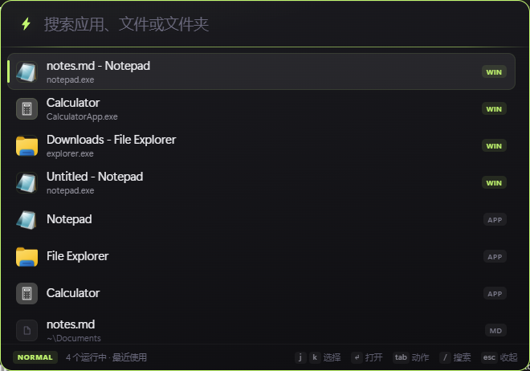

# Flint

一个用 Rust 写的 Windows 启动器：按 `Alt+Space` 召唤，输入几个字母，回车打开。

目标很单纯——**快到没有存在感**。没有动画等待，没有"正在加载"，没有满屏的托盘图标。



---

## 直接运行

`src-tauri/target/release/flint.exe`（5.9 MB，单文件，无需安装）

双击后它缩到托盘，按 `Alt+Space` 召唤。

---

## 用法

| 操作 | 快捷键 |
| --- | --- |
| 召唤 / 收起 | `Alt+Space` |
| 上下选择 | `↑` `↓` / `Ctrl+J` `Ctrl+K` |
| 打开 | `Enter` |
| **对选中项展开动作** | `Tab` |
| 打开所在文件夹 | `Ctrl+Enter` |
| 进入普通模式 | `Esc` / `Ctrl+[`（输入框有内容时） |
| 收起 | `Esc`（普通模式或输入框为空时）、点窗口外 |

### 动作面板

选中任意结果按 `Tab`，它不再只是「打开」一件事：

| 动作 | 说明 |
| --- | --- |
| 打开 | 等同于回车 |
| 打开所在位置 | 资源管理器里选中该文件 |
| 复制路径 | 完整路径进剪贴板 |
| 以管理员身份运行 | 走 `runas`，可执行文件才有 |
| 在此处打开终端 | 优先 Windows Terminal，没有则退回 cmd |
| 切换到此窗口 | 对已打开的窗口条目 |

`j`/`k` 选择，`Enter` 执行，`Esc` 返回搜索。

### Vim 模式

输入框是模态的，和 vim 一样：

- **INSERT**（默认）：直接打字搜索
- **NORMAL**：按 `Esc` 或 `Ctrl+[` 进入，输入框停止接收字符

| 键 | 动作 |
| --- | --- |
| `j` / `k` | 下 / 上 |
| `gg` / `G` | 跳到首 / 尾 |
| `Enter` | 打开 |
| `Ctrl+Enter` | 打开所在位置 |
| `i` `a` `/` | 回到 INSERT |
| `Esc` `q` | 收起 |

状态栏左侧会显示当前模式，NORMAL 时窗口边缘会亮起青柠色——不用低头看键盘也知道自己在哪个模式。

> `Ctrl+[` 是 `Esc` 的等价键。中文输入法下 `Esc` 常被吃掉用于取消候选，`Ctrl+[` 永远有效。

不想管模式也行：`Ctrl+J` / `Ctrl+K` 在两种模式下都能上下移动。

### 命令模式

输入 `>` 进入命令模式，不用记快捷键：

| 命令 | 作用 |
| --- | --- |
| 设置 | 索引目录与快捷路径 |
| 重建索引 | 重新扫描所有目录 |
| 开机自启 | 切换开机自动启动 |
| 退出 Flint | 关闭后台进程 |

### 自定义索引目录

默认只索引桌面 / 下载 / 文档。`>` → 设置，可以：

- **加目录**：把任何文件夹纳入索引，里面的文件立刻可搜
- **加快捷路径**：选一个文件夹，给它起个关键词（比如 `proj`），以后输入 `proj` 直接跳过去——哪怕那个目录里一个文件都还没索引

快捷路径在结果里带青柠色的「快捷」徽章，排在应用前面。

直接敲应用名或文件名即可，支持模糊匹配：

- `chr` → Chrome
- `vsc` → Visual Studio Code
- `report` → 报表.xlsx
- `dl` → Download 文件夹

**中文应用可以用英文名或拼音搜，常用软件也认缩写**:

| 输入 | 命中 |
| --- | --- |
| `calc` | 计算器（从包名 `WindowsCalculator` 里提取的英文） |
| `jisuanqi` | 计算器（全拼） |
| `jsq` | 计算器 / UU加速器 / 资源监视器（首字母） |
| `vscode` | Visual Studio Code（内置别名） |
| `vsc` | Visual Studio Code（词首缩写，通用规则） |
| `wt` | Windows Terminal |

排序上应用永远压过文件——搜 `vscode` 不会给你一堆名字里恰好有 v…s…c…o…d…e 的图片。

匹配到的字符会以青柠色高亮。常用的东西会自动往前提——启动过一次，权重就会记住。

托盘图标右键可以打开/重建索引/设置开机自启/退出。

---

## 它能找到什么

1. **已经打开的窗口** —— 排在所有结果最前面
2. **开始菜单里的所有应用** —— 包括 Win32 程序和 UWP / Microsoft Store 应用
3. **桌面、下载、文档里的文件和文件夹**（递归 6 层，自动跳过 `node_modules`、`.git`、`target`、`AppData` 这类不该扫的目录）

### 「已打开」优先，这是它和别的启动器最不一样的地方

大部分启动器只会「启动」。于是你搜 Chrome，它给你开第二个 Chrome 窗口——哪怕你已经开了十个标签页。

Flint 在每次召唤时枚举当前所有可见窗口。搜 `chrome`，排第一的是那个已经开着的窗口，带着青柠色的 `WIN` 徽章，按回车是**切过去**，不是新开一个。

窗口列表是实时的，所以刚关掉的窗口不会残留，新开的立刻能搜到。

索引范围在 `%LOCALAPPDATA%\Flint\settings.json` 里改（首次运行后生成）。

---

## 为什么快

| 环节 | 做法 |
| --- | --- |
| 召唤 | 窗口常驻内存，隐藏而非销毁。`ShowWindow` 级别的唤醒，不是冷启动 |
| 搜索 | `nucleo-matcher`（Helix 编辑器的匹配引擎）单次遍历打分，rayon 多线程分摊，八千条索引通常 **1–3 ms** |
| 索引 | 分两段：应用 1.3 秒就绪可搜，文件随后静默补上；下次启动直接读二进制快照 |
| 渲染 | 前端无框架、无构建、无 hydration，一次 `replaceChildren` 换掉整份列表 |
| 图标 | 提取后转 PNG 落盘缓存，之后是纯磁盘读；启动时预热头部 120 个应用 |
| 高亮 | 只在最终入选的 40 条上做，而不是给全量条目都算一遍位置 |

内存常驻大约 60–90 MB（主要是 WebView2 的运行时）。

## 踩过的坑（给后来的人）

- `SHCreateItemFromParsingName` 对 `/` 和 `\` 混用的路径直接返回 `E_INVALIDARG`，所有路径必须先规范化。
- WebView2 的键盘焦点在自己的子 HWND 上，`SetForegroundWindow` 不够，必须 `ICoreWebView2Controller::MoveFocus`，否则用户召唤后打的第一个字会掉进虚空。
- 但**不能**在 `WindowEvent::Focused(true)` 里调 MoveFocus：那时 webview 可能还在初始化，会让整页白屏（不报错、不 panic、日志干净）。只能在 `show_palette` 里 `show()` 之后调。
- `explorer /select,"path"` 用 `std::process::Command` 传会变成"打开默认文件夹"——它会给整个参数加引号，而 explorer 只认包裹路径本身的那种写法。走 `ShellExecuteW` 自己拼命令行。
- 窗口一 `show` 就触发 `Focused(false)`，失焦即隐藏的逻辑要留 400 ms 冷却，否则窗口闪一下就没了。
- ICO 的 `ICONDIRENTRY` 是 16 字节不是 18，且用 DIB 而非 PNG 格式兼容性最好。
- `transparent: true` 的窗口走 DirectComposition，`BitBlt` / `PrintWindow` 都抓不到画面。用截图验证 UI 时先临时把 transparent 关掉。

---

## 构建

```bash
cd src-tauri
cargo build --release
```

产物：`src-tauri/target/release/flint.exe`（单文件，约 5.7 MB，无外部依赖）。

需要：Rust 1.77+、WebView2 Runtime（Windows 11 自带）、MSVC 或 MinGW 工具链。

### 开机自启

托盘图标右键 → 勾选**开机自动启动**（写 `HKCU\...\CurrentVersion\Run`，不需要管理员权限）。取消勾选即可移除。

---

## 数据存放

全部在 `%LOCALAPPDATA%\Flint\`：

| 文件 | 用途 |
| --- | --- |
| `index.bin` | 索引快照（删掉会触发全量重建） |
| `freq.json` | 启动频率，用于排序加权 |
| `icons\` | 图标 PNG 缓存 |
| `settings.json` | 索引目录等配置 |

---

## 技术栈

- **Tauri 2** —— 窗口与 WebView 宿主，常驻进程模型
- **nucleo-matcher** —— 模糊匹配打分
- **rayon** —— 并行搜索
- **windows-rs** —— `ShellExecuteW` 启动、`IShellItemImageFactory` 取图标、`AttachThreadInput` 抢前台焦点
- **bincode** —— 索引序列化mechro
